```{r setup, include=FALSE}
knitr::opts_chunk$set(echo = FALSE, fig.pos = "H", out.extra = "")
options(knitr.table.format = function() {
  if (knitr::is_latex_output())
    "latex" else "html"
})
options(knitr.kable.NA = '')
```

```{r, include=FALSE}
library(tidyverse)
library(gridExtra)
library(kableExtra)
```

```{r echo=FALSE}
source("inc/functions.R")
```

\renewcommand{\listfigurename}{}
\renewcommand{\listtablename}{}

\pagenumbering{gobble}

\begin{center}
\vspace*{4\baselineskip}
{\Huge Topology optimisation in samaras:\\ using maple species as an example} \\
\vspace*{1\baselineskip}
{\large Topologieoptimierung bei Samaras (Flügelnussfrüchten) am Beispiel von Ahornarten} \\
\vspace*{2\baselineskip}
von \\
\vspace*{1\baselineskip}
{\huge Florian Mischke} \\
\vspace*{2\baselineskip}
geboren am \\
\vspace*{1\baselineskip}
{\large 11.01.1990} \\
\vspace*{2\baselineskip}
{\Large Bachelorarbeit im Studiengang Bachelor of Science Biologie\\der Universität Hamburg} \\
\vspace*{2\baselineskip}
2026
\vspace*{2\baselineskip}


{\large Gutachterin: Prof. Dr. Linnea Hesse} \\
{\large Gutachter: Prof. Dr. Dominik Begerow}
\end{center}

\newpage

\hypersetup{linkcolor = black}

\pagenumbering{roman}
\renewcommand*\contentsname{Table of Contents}
\tableofcontents

\newpage

\hypersetup{linkcolor = blue}

\pagenumbering{arabic}

# Statutory declaration {.unnumbered}

```{r}
# Source - https://stackoverflow.com/a/52687040
# Posted by Rob Smith, modified by community. See post 'Timeline' for change history
# Retrieved 2026-07-15, License - CC BY-SA 4.0
```

{width="100%"} \newpage

\ifoot{Florian Mischke - Topology optimisation in samaras: using maple species as an example}

```{r}
# \section{List of acronyms}
```

# List of acronyms {.unnumbered}

\begin{acronym} 
    \setlength{\parskip}{0ex}
    \setlength{\itemsep}{0ex}
    \acro{A}[A.]{Acer, scientific name of Maple}
    \acro{eg}[e.g.]{abbreviation for exempli gratia, a Latin phrase meaning "for example"}
    \acro{engl}[engl.]{English}
    \acro{ger}[ger.]{German}
    \acro{kit}[KIT]{Karlsruhe Institute of Technology}
    \acro{l}[L.]{Carl Linnaeus, also known as Carl von Linné}
    \acro{le}[LE]{leading edge}
    \acro{lev}[LEV]{leading-edge vortex}
    \acroplural{lev}[LEV]{leading-edge vortices}
    \acro{sd}[SD]{standard deviation}
    \acro{se}[SE]{standard error}
    \acro{vdi}[VDI]{Verein Deutscher Ingenieure e.V. - The Association of German Engineers e.V.}
    \acro{te}[TE]{trailing edge}
    \acro{zarm}[ZARM]{Zentrum für angewandte Raumfahrttechnologie und Mikrogravitation - Center of Applied Space Technology and Microgravity}
\end{acronym}

# Abstract

Abstract english

Zusammenfassung deutsch 

Something, something, something, Samaras.

# Introduction

## Samaras and their potential use in biomimetics
*Samaras* (figure \ref{fig:samara_denmark}) are winged autorotating diaspores (dispersal units) [@fauli_effect_2019]. Examples of these dispersal units can be found in maple species, among other plants.

```{r samara_denmark, echo=FALSE, out.width="100%", fig.align="left", fig.cap="\\textbf{Photo of a ripe samara found in Denmark,} \\textit{Acer} sp., probably \\textit{A. pseudoplatanus}. Own work"}
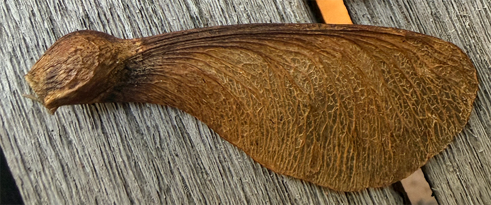
```

The term **biomimetics** is derived from the greek word *biomimesis*: [βίος (bios)]{.class lang="el"}, life, and [μίμησις (mīmēsis)]{.class lang="el"} [@noauthor_biomimetics_2026], imitation, meaning mimicking or imitating biology or living nature or organisms [@bhushan_introduction_2018]. Biomimetics is an interdisciplinary field at the interface of biology and engineering that seeks to address technical challenges through the abstraction, transfer, and application of insights derived from biological systems. The German term *Bionik* (not to be confused with *bionics*, which describes biomimetic electronics or robotics) is a portmanteau from the German words **Bio**logie (biology) and Tech**nik** (engineering).
According to Wikipedia, *bionics* is the application of biological systems in engineering and technology whereas the term *biomimetics* describes chemical reactions in a lab where smaller molecules than the macromolecules found in nature are used while being able to replicate the biochemistry of living organisms.
In this thesis though, the first definition is being used in accordance with \acs{vdi} (\acl{vdi}) [@noauthor_bionik_nodate].

```{=latex}
\noindent
\begin{minipage}[t]{0.33\textwidth}
\vspace{-\baselineskip}
```

```{r Ezra_et_al__tipuana_tipu, echo=FALSE, out.width="100%", fig.align="left", fig.cap="\\textbf{Parts of a samara}, using \\textit{Tipuana tipu} as an example: \\textbf{seed} at the bottom, sometimes referred to as \\textit{root}; \\textbf{rib} on the left side, referred to from here on as \\textit{leading edge}; \\textbf{wing} on the right side."}
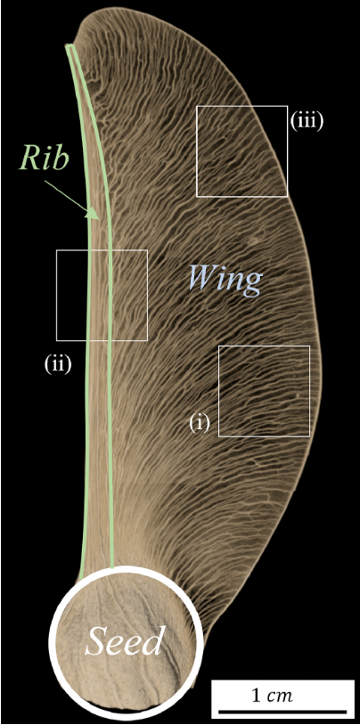
```

```{=latex}
\vspace{-\baselineskip}
```

Source: [@ezra_load-bearing_2023]

```{=latex}
\end{minipage}
\hfill
\begin{minipage}[t]{0.65\textwidth}
\vspace{0pt}
```

When looking at samaras flying or rather falling while autorotating thus slowing down the fall, one can easily come to the conclusion humankind can learn from these objects. Potential use cases are substitutes for parachutes, differently designed rotor blades for \acs{eg} helicopters, or a way to safely land sensor packages on the surface of the planet Mars. The latter is the reason for this bachelor thesis.\

Figure \ref{fig:Ezra_et_al__tipuana_tipu} shows what samaras consist of, using *Tipuana tipu* (not a species of maple) as an example.\

There has already been done a lot of work on this. Liu et al designed an abstracted rectangular artificial samara, which they call *maple-seed-inspired (MSI) rotochute*, claiming it had better efficacy than a natural maple seed (figure \ref{fig:Liu_et_al__msi_rotochute}). The maple samara's leading edge was replaced by a counterweight, the seed (or *root* as seen in figure \ref{fig:Liu_et_al__msi_rotochute}) by the *payload*.

```{=latex}
\end{minipage}
```

```{r Liu_et_al__msi_rotochute, echo=FALSE, out.width="75%", fig.align = "center", fig.show='hold', fig.cap="\\textbf{Design process of an artificial samara-like flyer.} (Original caption: 'Fabrication of the MSI rotochute.') (a) CT-Image of a maple samara; (b) mass distribution \"root\" (seed), \"counterweight\" (leading edge), and wing of a samara; (c) two level of abstraction of a maple samara; and (d) images of a constructed MSI rotochute."}
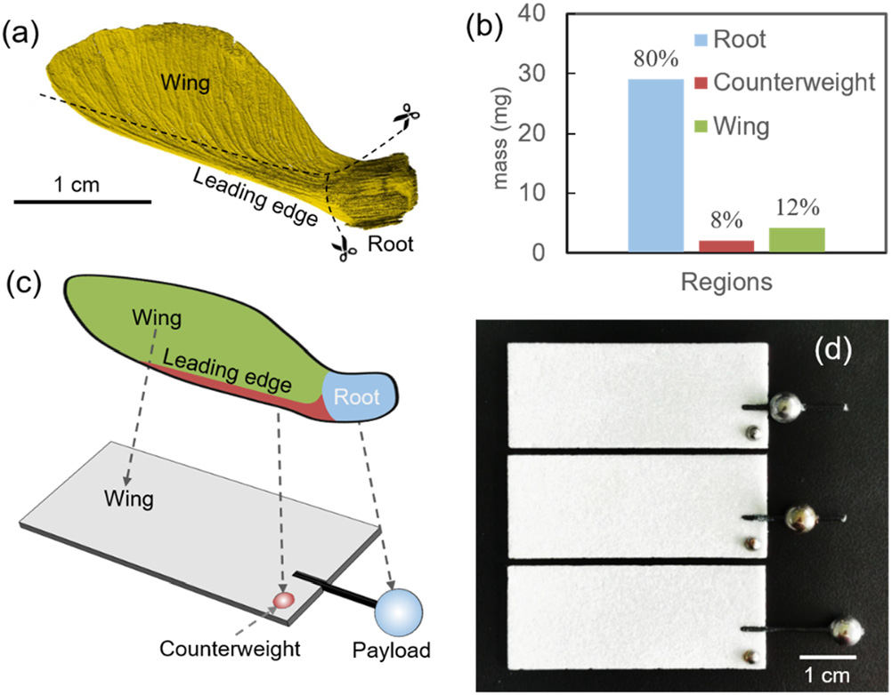
```
\vspace{-2em}Source: [@liu_maple-seed-inspired_2026]

## Leading-edge vortex (LEV)

Samara-bearing trees and shrubs depend on wind to succesfully disperse their seeds (*anemochory*). Samaras generate an unusually high lift that can be explained by the autorotation resulting in a \ac{lev} [@lentink_leading-edge_2009] and thus a reduced rate of descent, giving the samara more air time to be affected by the wind and reaching higher dispersal distances. The \acs{lev} is most prominent near the base of the samara, where the seed is located, at around 25% span, and merges with another vortex formed by the tip of the wing [@lentink_leading-edge_2009]. 

## Native maple species in Germany

Three maple species (figure \ref{fig:leaves_maple_species}) of the family Sapindaceae are considered to be native in Germany: *\acs{A} campestre* (\acs{engl} field maple, \acs{ger} Feld-Ahorn), *\acs{A} platanoides* (\acs{engl} Norway maple, \acs{ger} Spitz-Ahorn) and *\acs{A} pseudoplatanus* (\acs{engl} sycamore, \acs{ger} Berg-Ahorn) [@schmeil_flora_2024; @roloff_enzyklopaholzgewachse_2014].

```{r leaves_maple_species, echo=FALSE, out.width="30%", fig.align = "center", fig.show='hold', fig.cap="\\textbf{Leaves of native maple species in Germany.} (A) \\textit{A. campestre}, (B) \\textit{A. platanoides}, (C) \\textit{A. pseudoplatanus}."}
knitr::include_graphics(
  c("img/introduction/leaf_a_campestre.png",
    "img/introduction/leaf_a_platanoides.png",
    "img/introduction/leaf_a_pseudoplatanus.png")
)
```
\vspace{-2em}Images modified from: [@roloff_enzyklopaholzgewachse_2014]

All *Acer* fruits are schizocarp: when ripe, the individual carpels separate along their sutures and break down into single-seeded, nut-like, winged mericarps  [@schmeil_flora_2024] - the two (or, less commonly, three) samaras.
All three maple species in this study are *incompletely monoecious*; the flowers are hermaphroditic or functionally unisexual, while rudiments of the opposite sex are usually present [@schmeil_flora_2024].

Roloff et al. provide a detailed, in-depth description of the three maple species, among other trees. Here is an excerpt of the most valuable information for this thesis.

### *\acs{A} campestre* (field maple)
*\acs{A} campestre* occurs in dry to moist deciduous forests, riparian forests, and shrublands [@schmeil_flora_2024]. It presents as shrub or tree, blossoms in May, is 2-15 (sometimes up to 20) m high [@schmeil_flora_2024]. It can live to be between 150 and 200 years old, flowers start to develop at an age of about 25 years [@roloff_enzyklopaholzgewachse_2014]. 

Samaras ripen in late September/early October, get to be about 2.5 cm long,  face each other horizontally, and are usually covered with downy hairs, but are sometimes hairless [@roloff_enzyklopaholzgewachse_2014].

With 5,500 seeds per kilogram, the seed weight falls between that of *\acs{A} platanoides* and *\acs{A} pseudoplatanus* [@roloff_enzyklopaholzgewachse_2014].
The fruits therefore have a thousand-grain weight of about 182 g.

### *\acs{A} platanoides* (Norway maple)
*\acs{A} platanoides* occurs in mixed deciduous forests, but in some areas it is only naturalized and is commonly used as park or street tree [@schmeil_flora_2024]. It presents as tree, blossoms April to May, usually grows up to 20 (sometimes up to 35) m high [@schmeil_flora_2024], and gets to live for about 180 years [@roloff_enzyklopaholzgewachse_2014]. When growing in open areas, *\acs{A} platanoides* reaches sexual maturity as early as 10 to 15 years, but not until 25 to 30 years when growing in a stand [@roloff_enzyklopaholzgewachse_2014].

*\acs{A} platanoides* bears fruit abundantly almost every year and the samaras ripen in fall [@roloff_enzyklopaholzgewachse_2014]. They get to be about 5 cm long, hang down in pairs (sometimes in groups of three or more), and the upper edges of the two wings form an obtuse angle, which is a distinguishing feature from *\acs{A} campestre* (horizontal) and *\acs{A} pseudoplatanus* (acute angle) [@roloff_enzyklopaholzgewachse_2014].

The fruits have a thousand-grain weight (without wings) of 120 to 150 g [@roloff_enzyklopaholzgewachse_2014].

### *\acs{A} pseudoplatanus* (sycamore)
*\acs{A} pseudoplatanus* occurs in gorge forests and mountain forests, but in some areas it is only naturalized and is used as forest, park, or street tree [@schmeil_flora_2024]. It presents as tree, blossoms April to May, usually up to 25 (sometimes up to 30) m high [@schmeil_flora_2024].
In lowland areas, it can live to be between 150 years old, and 400-500 (up to 600) years in mountain areas, flowers start to develop at an age of about 30 years [@roloff_enzyklopaholzgewachse_2014]. 

The inflorescence is racemose with 40.000–170.000 fruits per 40 year old tree [@roloff_enzyklopaholzgewachse_2014]. The samara's wings get to be 3-6 cm long and have a usually distinctly rounded trailing edge [@roloff_enzyklopaholzgewachse_2014]. The samaras are always connected in pairs on the tree, forming an acute to right angle with each other [@roloff_enzyklopaholzgewachse_2014].

The fruits have a thousand-grain weight of 800 g, the average fruit weight is 128 mg and consists of 63% embryo, 22% pericarp, and 14% wing [@roloff_enzyklopaholzgewachse_2014].

## Tensile triangles after Mattheck

```{=latex}
\noindent
\begin{minipage}[t]{0.49\textwidth}
\vspace{-\baselineskip}
```

```{r mattheck_tensile_triangles, echo=FALSE, out.width="100%", fig.align="center", fig.cap="\\textbf{Examples of tensile triangles in nature.} (A) Transition from the root system to the tree trunk; (B) Bone; (C) rock formation due to erosion, gravity and breakage; (D) earth pyramids; (E) contour of a stone; (F) shape of a fish's head"}
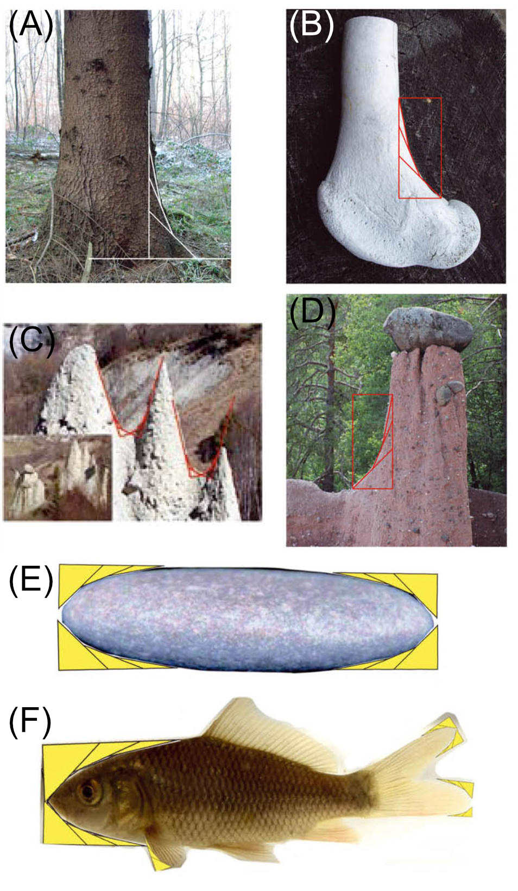
```

```{=latex}
\vspace{-\baselineskip}
```

Images modified from: [@mattheck_mattheck_nodate]

```{=latex}
\end{minipage}
\hfill
\begin{minipage}[t]{0.50\textwidth}
\vspace{0pt}
```

Prof. Dr. Claus Mattheck, \ac{kit}, found out that shapes of a significant number of biological structures and other structures found in nature (figure \ref{fig:mattheck_tensile_triangles}) can be described using so-called **tensile triangles**:\

\begin{quote}
\enquote{The tensile triangles curve appears to be a general design rule in nature with yet unknown limitations and potential.} 
\end{quote}
\hfill [&ndash; [@mattheck_pauli_2018]]{style="float:right"}\

Shapes following the tensile triangles curve have shown to reduce stress in notches [@mattheck_pauli_2018] and allow for efficient use of \enquote{building material} (\acs{eg} wood), and thereby confirming nature's optimzed architecture through evolution.\

### Uniaxial loading

In short, the method for uniaxial loading is as follows: an isosceles right triangle (figure \ref{fig:tensile_triangles_tree}, points EGF) is drawn at the base, \acs{eg} at the intercept of trunk and ground level. Using corner point G and center of the hypotenuse H, a second isosceles triangle is drawn. Repeating with corner point I and center point J, a third and final triangle is drawn.
The method is further explained in [Methods and Materials](#methods-and-materials).

```{r tensile_triangles_tree, echo=FALSE, out.width="100%", fig.align="center", fig.cap="\\textbf{Example of tensile triangles at a tree}. Own work."}
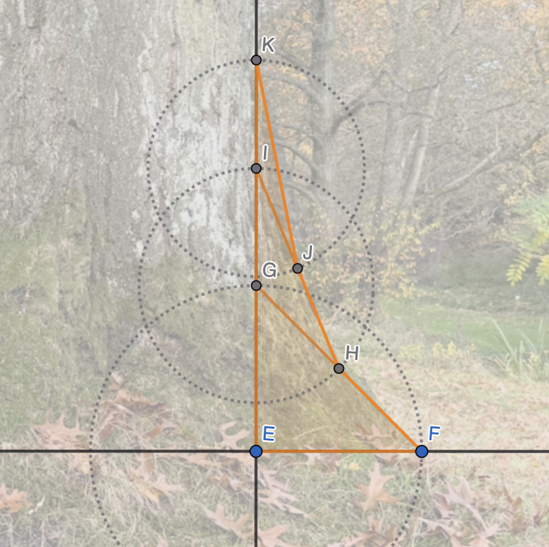
```

```{=latex}
\end{minipage}
```

### Biaxial loading

## Bézier curves

"For every Bézier curve, the control points are uniquely defined" [@baydas_defining_2019]
"a Bézier curve is established by the control points. When the control points are given, using the Bernstein polynomial and De Castaljeu algorithm we can write the Bézier curve" [@baydas_defining_2019]

```{r basic_bezier, echo=FALSE, out.width="100%", fig.align="left", fig.cap="\\textbf{Simple cubic bezier curve} with four control points in GeoGebra. Source: geogebra.org"}
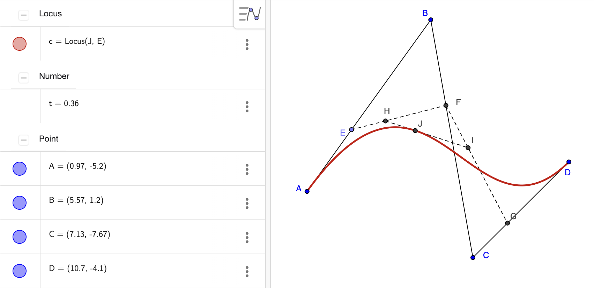
```

## Motivation: space exploration / landing technologies on Mars and other bodies

By simulating autorotational descend on multiple celestial bodies, Riegler et al came to the conclusion that \enquote{autorotation is not well suited to land large payloads on [Mars]} [@riegler_comparison_2025]. The simulation used vehicle parameters of 1000kg and a 4 rotor blade design. Experiments done in a drop tower at [\acs{zarm}](https://www.zarm.uni-bremen.de/en/) (\acl{zarm}) showed that samaras get into stable autoration in a Mars-like atmosphere (to be published).

**Body**          **Mass** [$kg$]   **Diameter** [$km$]   **Gravity** [$m/s^2$]
---------  ----------------------  --------------------  ----------------------
Earth        $5.97 \cdot 10^{24}$                12,756                     9.8
Mars        $0.642 \cdot 10^{24}$                  6792                     3.7
Venus        $4.87 \cdot 10^{24}$                12,104                     8.9
Titan$^1$   $0.135 \cdot 10^{24}$               5,149.4                     1.4
      
: Celestial body parameters [@noauthor_planetary_nodate]; [1] [@riegler_comparison_2025].  {#tab:planetary_parameters .class key="value"}

Table \ref{tab:planetary_parameters} compares planetary (and other celestial body) parameters, \ref{fig:atmospheric_density_comparison} compares atmospheric density among planets and Titan. These parameters greatly impact samara behavior.

This thesis aims to improve artificial samara design and thereby suggesting design parameters for novel experiments on landing technologies, mainly for Mars exploration.

```{r atmospheric_density_comparison, echo=FALSE, out.width="80%", fig.align = "center", fig.show='hold', fig.cap="\\textbf{Atmospheric Density Comparison} of the planets Earth, Mars, Neptun, Venus, and Titan, one of Saturn's moons."}
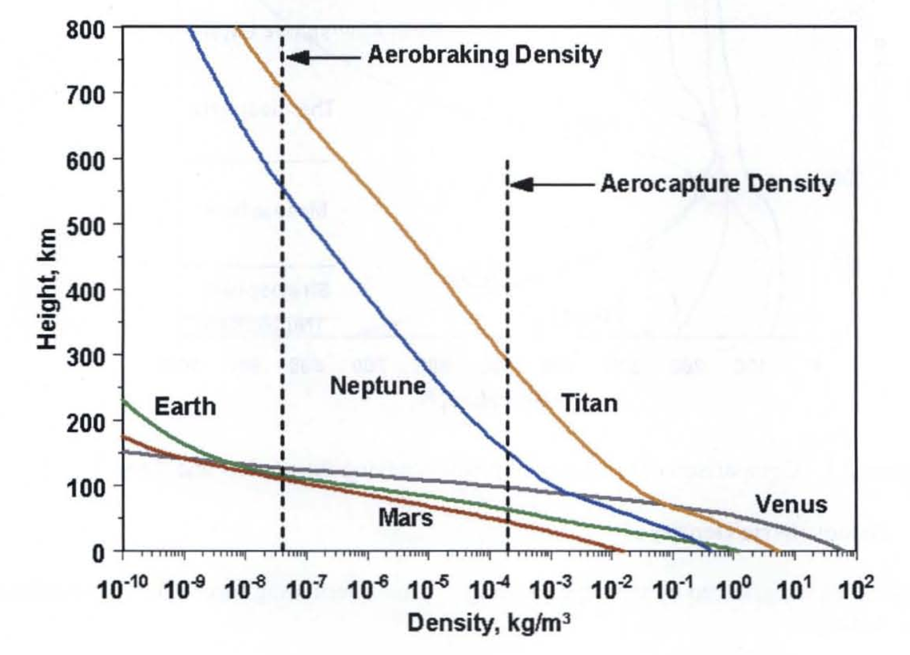
```
\vspace{-2em}Source: [@justus_atmospheric_2007]

# Methods and materials

## Samples

More than 200 mostly intact samaras of native maple species were gathered (\>50 per species/location), defective samaras have been discarded so that at least 50 intact samples could be used. The sample's species were identified based on the shape of the leaves (figures \ref{fig:leaves_maple_species}, \ref{fig:maple_leaves_schmeil}), cross-referenced with the samara topology (figure!!) of the closest tree, and it was made sure that no other species of maple were near the gathering site. The four species and locations were as follows:

1.  *Acer campestre* \acs{l}- Loki Schmidt Garten, Hamburg - what3words: [///kennels.slippery.hears](https://w3w.co/kennels.slippery.hears)
2.  *Acer pseudoplatanus* \acs{l}- Stadtpark, Hamburg - what3words: [///engaging.survey.spout](https://w3w.co/engaging.survey.spout)
3.  *Acer platanoides* \acs{l}- Spannskamp, Hamburg - what3words: [///bristle.ruins.curated](https://w3w.co/bristle.ruins.curated)
4.  *Acer platanoides* \acs{l}- IPM, Hamburg - what3words: [///gardens.rattled.yappy](https://w3w.co/gardens.rattled.yappy)

The web service what3words was used as an easy way to keep track of locations.
All samples were gathered between June 22nd and June 28th 2026.

```{r maple_leaves_schmeil, echo=FALSE, out.width="100%", fig.align = "center", fig.show='hold', fig.cap="\\textbf{Leaves of native maple species in Germany.} (A) \\textit{A. campestre}, (B) \\textit{A. platanoides}, (C) \\textit{A. pseudoplatanus}."}
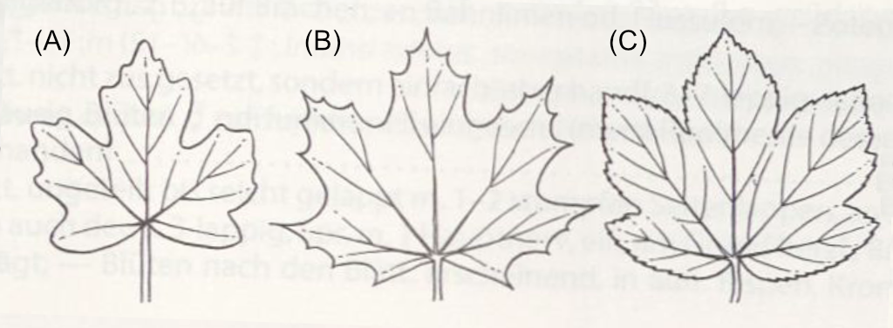
```
\vspace{-2em}Image modified from: [@schmeil_flora_2024]

## Photos for measuring and geometry experiments

An A3 sheet of millimeter paper was placed on the ground and secured with transparent sticky tape. A 10x4 cm cutout of white printer paper was taped on it. One samara at a time was placed on that paper and a sticky note with date/time and species name was placed below.\
A digital camera (Panasonic Lumix G, Model No. DC-FZ100002) was secured on a tripod stand at maximum height, pointed down and leveled via spirit level. Distance from ground to camera lens was measured 134cm. The following settings were chosen to take photos: Focal length 400, S 4, F 11, ISO 125; manual mode. Photos of the setup were taken, see figure \ref{fig:camera_setup}.

50 photos for *Acer pseudoplatanus* and *\acs{A} campestre* and 100 photos for *\acs{A} platanoides* (50 for each of the two samples) were taken by remote control with the Panasonic Image App. The photos were copied to a Laptop and backed up to cloud storage and an external SSD.

```{r, echo=FALSE, out.width="45%", fig.align = "center", fig.show='hold', fig.cap="\\label{fig:camera_setup}\\textbf{Camera setup.} Camera on tripod pointed down on millimeter sheet of paper. Samara is positioned on the white paper strip (left). View of a samara (A. platanoides) through the camera lens/display (right). Source: own work"}
# Source - https://stackoverflow.com/a/63866499
# Posted by Werner Hertzog, modified by community. See post 'Timeline' for change history
# Retrieved 2026-08-03, License - CC BY-SA 4.0
knitr::include_graphics(
  c("img/setup/IMG_4753.jpeg",
    "img/setup/IMG_4594.jpeg")
)
```

## Measuring samaras in FIJI

After opening a photo of a samara in FIJI, four centimeteres were marked using the millimeter sheet (figure \ref{fig:P1116384}). The scale was then set via *Set Scale...* which autofilled the marked pixels. The output was recorded in the macro that was used to measure all the samples, as shown below:
\begin{verbatim}
// Set Scale
run("Set Scale...", "distance=1457.0124 known=4 unit=cm");
\end{verbatim}

```{r}
px_per_mm <- 1457.0124/40
mm_per_px <- 40/1457.0124
```


```{r P1116384, echo=FALSE, out.width="50%", fig.align = "center", fig.show='hold', fig.cap="\\textbf{Photo of a sample of \\textit{A. pseudoplatanus}.} Source: own work"}
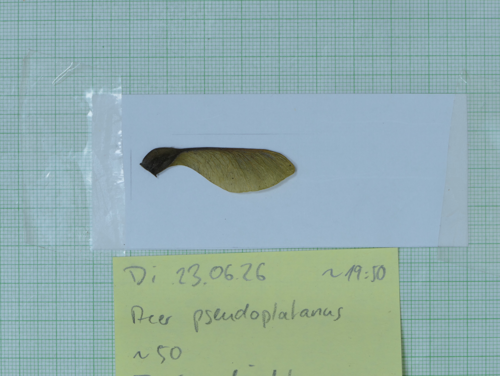
```

A FIJI macro was written and used to automatically measure the samara's dimensions. The macro first converted the image to a mask with a set threshold of `0,140`, then cropped, then started a particle analysis in which the biggest length of the largest found area was measured. After that the greatest width perpendicular to that length was measured. Lines were drawn onto the mask and results written into the top left corner of the image (figure \ref{fig:P1116384_processed}) as well as written into a CSV (comma-separated values) file.

```{r P1116384_processed, echo=FALSE, out.width="100%", fig.align = "center", fig.show='hold', fig.cap="\\textbf{Sample of \\textit{A. pseudoplatanus} after processing with FIJI macro.} Source: own work"}
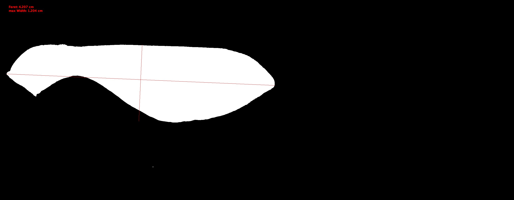
```

The results were processed in R code in a `.Rmd` file in RStudio by Posit Software. Mean, standard deviation, standard error and variance were calculated for all samples and for each species/sample separately. Length/width ratios were calculated and tests (Shapiro-Wilk, Levene, ANOVA, Kruskal-Wallis) performed.

## Geometry experiments in GeoGebra and Affinity

### Tensile triangles

```{r mattheck1, echo=FALSE, out.width="100%", fig.align = "center", fig.show='hold', fig.cap="\\textbf{Mattheck method applied to wing tip of a sample of \\textit{A. platanoides}.} Source: own work"}
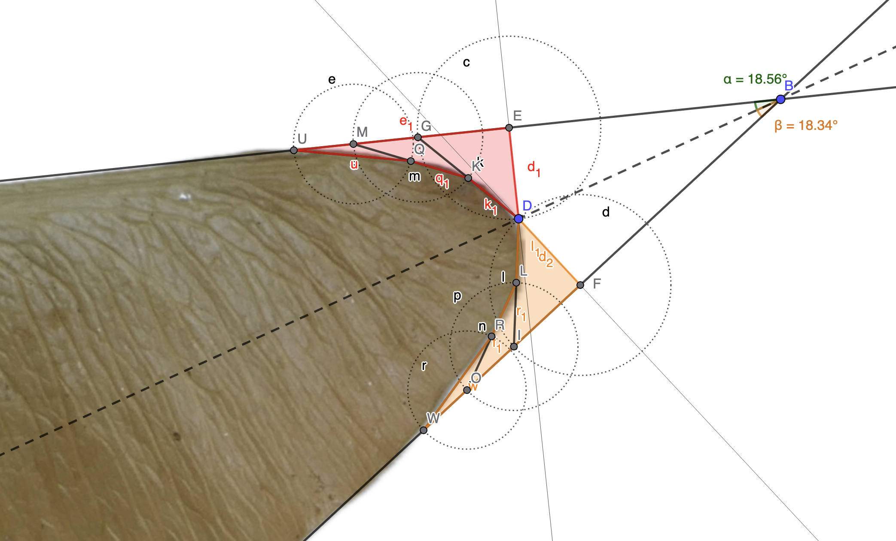
```

### Bézier curves

The first Bézier curve experiments were done in Geogebra (figure \ref{fig:geogebra_bezier}; [geogebra.org](https://www.geogebra.org/)). Since this web service can't handle large images and downscales them, cropped sections were used. As the sections were not the same size, Geogebra treated them differently. Therefore the results were not comparable. \par
\indent From then on, Affinity suite ([affinity.studio](https://www.affinity.studio/)) was used for all measurements. Cubic Beziér curves were drawn manually with the Pen tool and fitted to the shape of the samara's trailing edge and leading edge respectively with the Node tool (figure \ref{fig:bezier_pseudoplatanus_affinity}). The curve was exported as SVG and all SVG files handled by a custom Python script, resulting in a machine-readable CSV file, that was imported by R code.

```{r P1116641_bezier, echo=FALSE, out.width="70%", fig.align = "center", fig.show='hold', fig.cap="Bézier curve on a sample of Acer platanoides Source: own work"}
#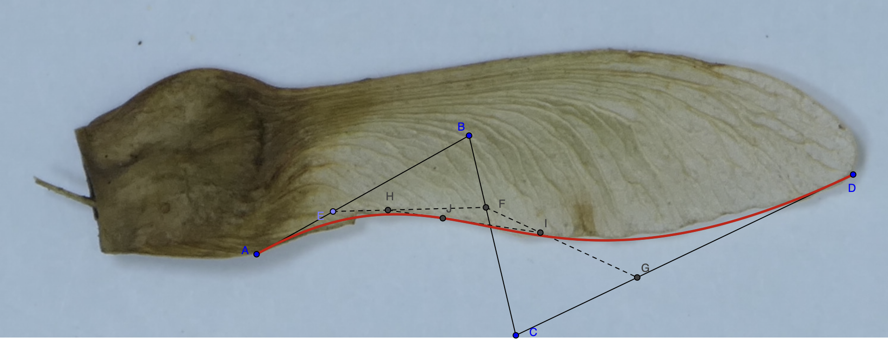
```

```{r P1116588_bezier, echo=FALSE, out.width="70%", fig.align = "center", fig.show='hold', fig.cap="Bézier curve on a sample of Acer campestre Source: own work"}
#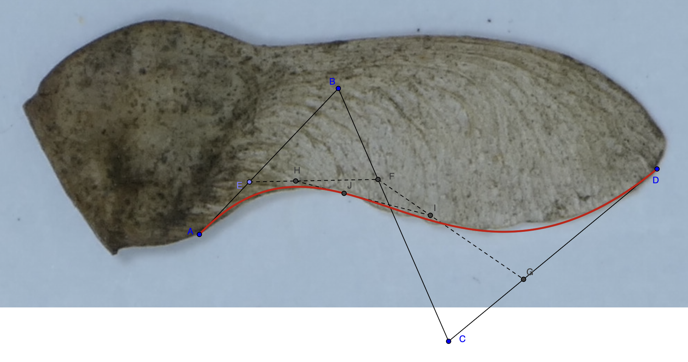
```

```{r P1116384_bezier, echo=FALSE, out.width="70%", fig.align = "center", fig.show='hold', fig.cap="Bézier curve on a sample of Acer pseudoplatanus. Source: own work"}
#nitr::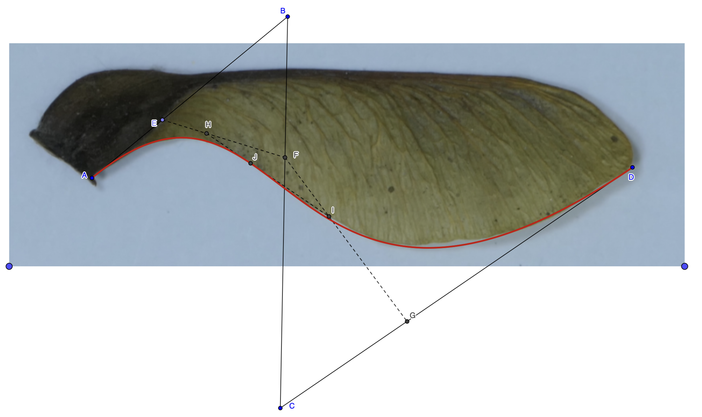
```

```{r geogebra_bezier, echo=FALSE, out.width="32%", fig.align = "center", fig.show='hold', fig.cap="\\textbf{Bézier curves} on samples of (A) \\textit{A. campestre}; (B) \\textit{A. platanoides}; and (C) \\textit{A. pseudoplatanus}; in GeoGebra. Source: own work"}
knitr::include_graphics(
  c("img/geogebra/bezier_campestre_geogebra_.png",
    "img/geogebra/bezier_platanoides_geogebra_.png",
    "img/geogebra/bezier_pseudoplatanus_geogebra_.png")
)
```

```{r bezier_pseudoplatanus_affinity, echo=FALSE, out.width="100%", fig.align = "center", fig.show='hold', fig.cap="\\textbf{Sample of \\textit{A. pseudoplatanus} with drawn in Bézier curves in Affinity.} Source: own work"}
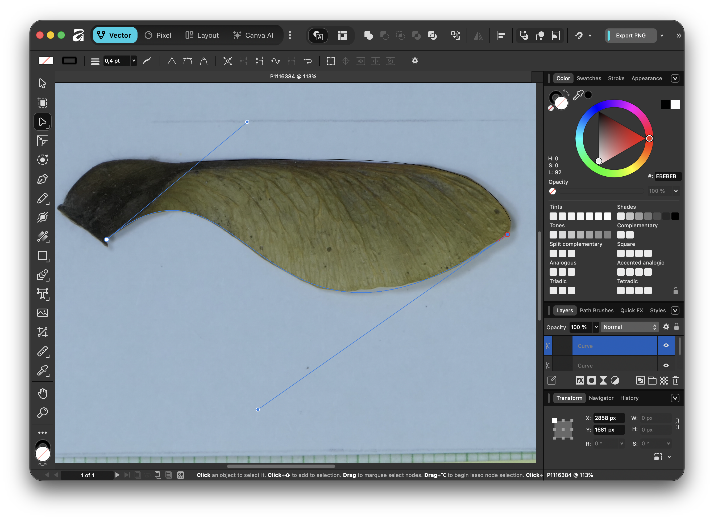
```

## Stained sections

Two fresh samaras each of *Acer campestre* and *A. pseudoplatanus* were conserved in 60% Ethanol.

# Results

## FIJI measurements

```{r echo=FALSE}
results <- read.csv("data/2026-07-14--09-56--Results.csv")

results <- results |> mutate(
  FeretLength_mm = Feret*10,
  maxWidth_mm = maxWidth*10,
  ratio = FeretLength_mm / maxWidth_mm)

#str(results)
#summary(results)

summary <- results |> summarise(
  'mean_feret_mm' = mean(FeretLength_mm),
  'var_feret_mm' = var(FeretLength_mm), # variance
  'sd_feret_mm' = sd(FeretLength_mm), # standard deviation
  'se_feret_mm' = fm_se(FeretLength_mm), # standard error
  'mean_width_mm' = mean(maxWidth_mm),
  'var_width_mm' = var(maxWidth_mm), # variance
  'sd_width_mm' = sd(maxWidth_mm), # standard deviation
  'se_width_mm' = fm_se(maxWidth_mm) # standard error
)

colnames(summary) <- c("Mean Feret length", "Variance of Feret lengths", "SD of Feret lengths", "SE of Feret lengths",
                       "Mean max width", "Variance of max widths", "SD of max widths", "SE of max widths")

kable(summary[1:4], format = "latex", booktabs = TRUE, caption = "Results of Feret lengths (mm)", label = "feret") |> kable_styling(latex_options = "HOLD_position")
kable(summary[5:8], format = "latex", booktabs = TRUE, caption = "Results of max widths (mm)", label = "widths") |> kable_styling(latex_options = "HOLD_position")
```
\ac{sd}; \ac{se} 

```{r echo=FALSE}
samples_images <- readxl::read_excel("data/samples_images.xlsx") 
```

```{r echo=FALSE}
my_data <- merge(x = results, y = samples_images, by = "FileName", all = TRUE)
my_data <- my_data |> mutate(
  sample = paste(Species, Location, sep = "\n")
) |> group_by(sample) |> mutate(
  n = n(),
  label = paste0(sample,'\nn = ',n)
)
my_data_longer <- my_data |> pivot_longer(cols = c(FeretLength_mm,maxWidth_mm), names_to = "unit_mm", values_to = "value")
```

```{r echo=FALSE}
summary_detailed <- my_data |> group_by(Species, Location) |> drop_na() |> summarize(
  'mean_feret_mm' = mean(FeretLength_mm),
  'var_feret_mm' = var(FeretLength_mm), # variance
  'sd_feret_mm' = sd(FeretLength_mm), # standard deviation
  'se_feret_mm' = fm_se(FeretLength_mm), # standard error
  'mean_width_mm' = mean(maxWidth_mm),
  'var_width_mm' = var(maxWidth_mm), # variance
  'sd_width_mm' = sd(maxWidth_mm), # standard deviation
  'se_width_mm' = fm_se(maxWidth_mm), # standard error
  n = n(),
  .groups = "drop"
)
```

```{r echo=FALSE}

t_summary_detailed <- t(summary_detailed)

# Arten und Standorte aus der bereits transponierten Matrix auslesen
species  <- as.character(t_summary_detailed["Species", ])
location <- as.character(t_summary_detailed["Location", ])

# Messgrößen auswählen und in einen Data Frame umwandeln
tab <- as.data.frame(
  t_summary_detailed[
    c(
      "mean_feret_mm",
      "var_feret_mm",
      "sd_feret_mm",
      "se_feret_mm",
      "mean_width_mm",
      "var_width_mm",
      "sd_width_mm",
      "se_width_mm",
      "n"
    ),
    ,
    drop = FALSE
  ],
  stringsAsFactors = FALSE
)

# Messwerte numerisch konvertieren
tab[] <- lapply(tab, as.numeric)

# Zeilenbezeichnungen lesbar gestalten
rownames(tab) <- c(
  "Mean Feret diameter (mm)",
  "Variance Feret diameter (mm)",
  "SD Feret diameter (mm)",
  "SE Feret diameter (mm)",
  "Mean width (mm)",
  "Variance width (mm)",
  "SD width (mm)",
  "SE width (mm)",
  "Sample size (n)"
)

# Arten gruppieren
species_groups <- rle(species)

header <- c(
  " " = 1,
  setNames(
    as.numeric(species_groups$lengths),
    species_groups$values
  )
)

# Tabelle erstellen
kbl(
  tab,
  format = "latex",
  booktabs = TRUE,
  linesep = "",
  caption = "Summary of Fiji measurements by species and location",
  label = "tab:summary_detailed",
  col.names = location,
  align = c("l", rep("c", ncol(tab))),
  digits = 3
) |>
  add_header_above(header, escape = TRUE) |>
  row_spec(4, extra_latex_after = "\\addlinespace") |>
  row_spec(8, extra_latex_after = "\\addlinespace") |>
  kable_styling(
    latex_options = c("HOLD_position", "scale_down"),
    full_width = FALSE,
    font_size = 9
  )
```

```{r feret_width_three_acer_species, fig.cap="\\label{fig:feret_width_three_acer_species_label}Feret lengths and maximum widths of three Acer species."}
n_species <- my_data |>
  group_by(Species) |>
  summarise(n = n(), .groups = "drop")

my_data_longer |> ggplot(
  mapping = aes(
    x = Species,
    y = value,
    color = factor(unit_mm, labels = c("Feret length", "maximum width"))
  )
) + geom_boxplot(na.rm=TRUE) +
  #ggtitle("Feret lengths and maximum widths of three Acer species.") +
  labs(x = "Species", y = "[mm]", color = "") +
  scale_x_discrete(
    labels = function(x) {
      paste0(x, "\n(n = ", n_species$n[match(x, n_species$Species)], ")")
    }
  ) +
  theme_minimal() +
  theme(axis.text.x = element_text(angle = 45, vjust = 1, hjust=1))
```

```{r feret_width_two_platanoides_samples, fig.cap="\\label{fig:feret_width_two_platanoides_samples_label}Feret lengths and maximum widths of two samples of Acer platanoides."}
my_data_longer |> filter(Species == "Acer platanoides") |> ggplot(
  mapping = aes(
    x = label,
    y = value,
    color = factor(unit_mm, labels = c("Feret length", "maximum width"))
  )
) + geom_boxplot(na.rm=TRUE) +
  theme_minimal() +
  #ggtitle("Feret lengths and maximum widths of two samples of Acer platanoides.") +
  labs(x = "Location", y = "[mm]", color = "")
```

```{r feret_width_four_acer_samples, fig.cap="\\label{fig:feret_width_four_acer_samples_label}Feret lengths and maximum widths of four samples of Acer species."}
my_data_longer |> ggplot(
  mapping = aes(
    x = label,
    y = value,
    color = factor(unit_mm, labels = c("Feret length", "maximum width"))
  )
) + geom_boxplot(na.rm=TRUE) +
  #ggtitle("Feret lengths and maximum widths of four samples of Acer species.") +
  labs(x = "Species and Location", y = "[mm]", color = "") +
  theme_minimal() +
  theme(axis.text.x = element_text(angle = 45, vjust = 1, hjust=1))
```

## Length/width ratios

```{r ratios_boxplot, fig.cap="\\label{fig:ratios_boxplot_label}Length/width ratios of four samples of Acer species"}
my_data |> ggplot(
  mapping = aes(
    x = label,
    y = ratio,
  )
) + geom_boxplot(na.rm=TRUE) +
  #ggtitle("Length/width ratios of four samples of Acer species") +
  labs(x = "Species and Location", y = "Ratio", color = "") +
  theme_minimal() +
  theme(axis.text.x = element_text(angle = 45, vjust = 1, hjust=1))
```

```{r ratios_hist, fig.cap="\\label{fig:ratios_hist_label}Length/width ratios of four samples of Acer species"}
my_data |> ggplot(
  mapping = aes(
    x = ratio
  )
) + geom_histogram(bins=50,na.rm = TRUE) +
  facet_wrap(~label) +
  theme_minimal()
```

### Shapiro-Wilk test

H0: sample comes from a normally distributed population.
HA: no normal distribution.

```{r}
shapiro_Acampestre <- shapiro.test(my_data$ratio[my_data$Species == "Acer campestre"])

shapiro_Aplatanoides_IPM <- shapiro.test(my_data$ratio[my_data$Species == "Acer platanoides" & my_data$Location == "IPM"])

shapiro_Aplatanoides_Spannskamp <- shapiro.test(my_data$ratio[my_data$Species == "Acer platanoides" & my_data$Location == "Spannskamp"])

shapiro_Apseudoplatanus <- shapiro.test(my_data$ratio[my_data$Species == "Acer pseudoplatanus"])

shapiro_table <- data.frame(
  Sample = c("Acer campestre", "Acer platanoides (IPM)", "Acer platanoides (Spannskamp)", "Acer pseudoplatanus"),
  Statistic = c(shapiro_Acampestre$statistic, shapiro_Aplatanoides_IPM$statistic, shapiro_Aplatanoides_Spannskamp$statistic, shapiro_Apseudoplatanus$statistic),
  p = c(shapiro_Acampestre$p.value, shapiro_Aplatanoides_IPM$p.value, shapiro_Aplatanoides_Spannskamp$p.value, shapiro_Apseudoplatanus$p.value),
  normality = c("no, p < 0.001","no, p < 0.01", "yes, p > 0.5", "no, p < 0.01")
)

kable(shapiro_table,
  format = "latex",
  booktabs = TRUE,
  caption = "Results of Shapiro-Wilk tests",
  label = "shapiro") |> kable_styling(latex_options = "HOLD_position")
```

### Levene test

H0: homogeneity of variance.
HA: at least one group with variance unequal to others.

```{r}
my_data$sample <- as.factor(my_data$sample)
levene_results <- car::leveneTest(ratio ~ sample, my_data)

#levene_table <- data.frame(
#  c("Df", "F value", "Pr(>F)")
#)
kable(
  levene_results,
  format = "latex",
  booktabs = TRUE,
  digits = 3,
  caption = "Levene test results",
  label = "levene"
) |> kable_styling(latex_options = "HOLD_position")
```

### ANOVA

Ratio \~ sample

```{r}
mod <- aov(formula = my_data$ratio ~ my_data$sample, data = my_data)

#summary(mod)

anova_tab <- summary(mod)[[1]]
anova_tab$`Pr(>F)` <- format.pval(anova_tab$`Pr(>F)`, digits = 4, na.form="")
kable(anova_tab,
  format = "latex",
  booktabs = TRUE,
  caption = "ANOVA results",
  label = "anova") |> kable_styling(latex_options = "HOLD_position")
```

Table \ref{tab:anova} shows Anova results.

### Kruskal-Wallis test

```{r}
kruskal <- kruskal.test(ratio ~ sample, data = my_data)

kruskal_table <- data.frame(
  Method = kruskal$method,
  Statistic = unname(kruskal$statistic),
  Degrees_of_Freedom = unname(kruskal$parameter),
  P_value = format.pval(kruskal$p.value, digits = 4)
)

kable(kruskal_table,
  format = "latex",
  booktabs = TRUE,
  digits = 3,
  caption = "Kruskal-Wallis test",
  label = "kruskal") |> kable_styling(latex_options = "HOLD_position")
```

* p-value $< 0.05$: Evidence of a statistically significant difference between at least two groups.
* p-value $\geq 0.05$: Insufficient evidence to conclude that the groups differ.

## Topology Optimization after Mattheck

## Bézier curves

### Trailing Edge

Figures \ref{fig:bezier_pseudoplatanus_affinity} and \ref{fig:geogebra_bezier} shows that the shapes of all three maple species can be described by Bézier curves.

#### Bézier curve simulation

```{r}
v_linetypes = c(
      "1" = "solid",
      "2" = "dashed",
      "3" = "dotted",
      "4" = "dotdash",
      "5" = "longdash",
      "6" = "twodash"
    )
```

```{r}
library(bezier)
t <- seq(0, 1, length=100)
p <- matrix(c(0.48,6.04, 9.56,13.54, 9.22,-4.65, 25.58,6.54), nrow=4, ncol=2, byrow=TRUE)
bezier_points <- bezier(t=t, p=p)

df_bezier_points <- data.frame(bezier_points)
colnames(df_bezier_points) <- c("X","Y")

colnames(p) <- c("X","Y")
rownames(p) <- c("A","B","C","D")
kable(p, format = "latex", booktabs = TRUE, caption = "Control points of first attempt of bezier curve on sample of A. pseudoplatanus", label = "control_points") |> kable_styling(latex_options = "HOLD_position")
```

Formula \ref{bezier_dummy}

$$
\begin{equation}
\mathbf{P}(t) = (1-t)^3
\begin{pmatrix}
`r p["A","X"]`\\`r p["A","Y"]`
\end{pmatrix}
+3(1-t)^2t
\begin{pmatrix}
`r p["B","X"]`\\`r p["B","Y"]`
\end{pmatrix}
+ 3(1-t)t^2
\begin{pmatrix}
`r p["C","X"]`\\`r p["C","Y"]`
\end{pmatrix}
+ t^3
\begin{pmatrix}
`r p["D","X"]`\\`r p["D","Y"]`
\end{pmatrix}
\label{bezier_dummy}\end{equation}
$$

Figure \ref{fig:bezier_curve_simulation}

```{r bezier_curve_simulation, echo=FALSE, out.width="100%", fig.align = "center", fig.show='hold', fig.cap="Bézier curve simulation. Source: own work"}

df_bezier_points |> ggplot(
  mapping = aes(
    x = X,
    y = Y
  )
) + 
  geom_line(color = "red") + 
  coord_fixed(ratio = 1) + 
  theme_minimal()
```

```{r}
data_curve_points <- read.csv("svg/svg_points.csv")
data_curve_points_merged <- data_curve_points |> mutate(
  key = str_remove(FileName, "\\.[^.]+$")
) |> left_join(
  samples_images |> mutate(
    key = str_remove(FileName, "\\.[^.]+$")
), by = "key"
)
```

```{r bezier_curves_3species_raw, echo=FALSE, out.width="100%", fig.align = "center", fig.show='hold', fig.cap="Bézier curve simulation of three Acer species, raw data - not adjusted to same origin. Source: own work"}
bezier_df_unadjusted <- data_curve_points_merged |> 
  group_by(FileName.x, Species) |> 
  group_modify(~ {

    # Kontrollpunkte A, B, C, D
    # Jede Zeile = ein Kontrollpunkt
    control_points <- as.matrix(.x[, c("X", "Y")])

    # Parameter t
    t <- seq(0, 1, length.out = 100)

    # Kubische Bézier-Kurve aus 4 Kontrollpunkten
    curve <- bezier(
      t = t,
      p = control_points
    )

    # Als Dataframe zurückgeben
    data.frame(
      t = t,
      X = curve[, 1],
      Y = curve[, 2]
    )
  }) |> 
  ungroup()

bezier_df_unadjusted <- bezier_df_unadjusted |> 
  group_by(Species) |> 
  mutate(
    Sample = dense_rank(FileName.x)
  ) |> 
  ungroup()

# Kurven plotten
bezier_df_unadjusted |> group_by(Species) |> mutate(
  n = n_distinct(FileName.x),
  label = paste0(Species,'\nn = ',n)
) |> ggplot(aes(x = X, y = Y, group = FileName.x, color = label, linetype = factor(Sample))) +
  geom_path(linewidth = 0.5, alpha = 0.5) +
  coord_equal() +
  theme_minimal() +
  theme(legend.position = 'bottom') +
  guides(linetype = "none") +
  scale_linetype_manual(
    values = v_linetypes
  )
```

```{r bezier_curves_3species, echo=FALSE, out.width="100%", fig.align = "center", fig.show='hold', fig.cap="Bézier curve simulation of three Acer species. Source: own work"}
# Globalen Mittelpunkt aller ursprünglichen A-Punkte berechnen
A_global <- data_curve_points_merged |> 
  filter(Point == "A") |> 
  summarise(
    X_A = mean(X, na.rm = TRUE),
    Y_A = mean(Y, na.rm = TRUE)
  )

D_global <- data_curve_points_merged |> 
  filter(Point == "D") |> 
  summarise(
    X_D = mean(X, na.rm = TRUE),
    Y_D = mean(Y, na.rm = TRUE)
  )


# Für jede Kurve den individuellen A-Punkt bestimmen
data_curve_points_adjusted <- data_curve_points_merged |> 
  group_by(FileName.x) |> 
  mutate(
    X_A_original = X[Point == "A"][1],
    Y_A_original = Y[Point == "A"][1],
    
    X = X - X_A_original + A_global$X_A,
    Y = Y - Y_A_original + A_global$Y_A
  ) |> 
  ungroup() |> 
  select(-X_A_original, -Y_A_original)

bezier_df <- data_curve_points_adjusted |> 
  group_by(FileName.x, Species) |> 
  group_modify(~ {

    # Kontrollpunkte A, B, C, D
    # Jede Zeile = ein Kontrollpunkt
    control_points <- as.matrix(.x[, c("X", "Y")])

    # Parameter t
    t <- seq(0, 1, length.out = 100)

    # Kubische Bézier-Kurve aus 4 Kontrollpunkten
    curve <- bezier(
      t = t,
      p = control_points
    )

    # Als Dataframe zurückgeben
    data.frame(
      t = t,
      X = curve[, 1],
      Y = curve[, 2]
    )
  }) |> 
  ungroup()

bezier_df <- bezier_df %>%
  group_by(Species) %>%
  mutate(
    Sample = dense_rank(FileName.x)
  ) %>%
  ungroup()

# Kurven plotten
bezier_df |> group_by(Species) |> mutate(
  n = n_distinct(FileName.x),
  label = paste0(Species,'\nn = ',n)
) |> ggplot(aes(x = X, y = Y, group = FileName.x, color = label, linetype = factor(Sample))) +
  geom_path(linewidth = 0.5, alpha = 0.5) +
  coord_equal() +
  theme_minimal() +
  theme(legend.position = 'bottom') +
  guides(linetype = "none") +
  scale_linetype_manual(
    values = v_linetypes
  )
```

```{r bezier_curves_transformed, echo=FALSE, out.width="100%", fig.align = "center", fig.show='hold', fig.cap="Bézier curve simulation with transformed data of three Acer species. Source: own work"}
target_length <- 100

mean_angle <- atan2(
  D_global$Y_D - A_global$Y_A,
  D_global$X_D - A_global$X_A
)

mean_length <- sqrt(
  (D_global$X_D - A_global$X_A)^2 +
  (D_global$Y_D - A_global$Y_A)^2
)

data_curve_points_transformed <- data_curve_points_adjusted |> 
  group_by(FileName.x) |> 
  mutate(
    X_A = A_global$X_A,
    Y_A = A_global$Y_A,
    
    X_D = X[Point == "D"][1],
    Y_D = Y[Point == "D"][1],
    
    AD_X = X_D - X_A,
    AD_Y = Y_D - Y_A,
    
    angle_D = atan2(AD_Y, AD_X),
    rotation = mean_angle - angle_D,
    
    length_D = sqrt(AD_X^2 + AD_Y^2),
    
    X_rel = X - X_A,
    Y_rel = Y - Y_A,
    
    X_rot = X_rel * cos(rotation) - Y_rel * sin(rotation),
    Y_rot = X_rel * sin(rotation) + Y_rel * cos(rotation),
    
    X = X_rot * mean_length / length_D + X_A,
    Y = Y_rot * mean_length / length_D + Y_A
  ) |> 
  ungroup() |> 
  select(
    -X_A, -Y_A,
    -X_D, -Y_D,
    -AD_X, -AD_Y,
    -angle_D, -rotation,
    -length_D,
    -X_rel, -Y_rel,
    -X_rot, -Y_rot
  )

bezier_df_transformed <- data_curve_points_transformed |> 
  group_by(FileName.x, Species) |> 
  group_modify(~ {

    # Kontrollpunkte A, B, C, D
    # Jede Zeile = ein Kontrollpunkt
    control_points <- as.matrix(.x[, c("X", "Y")])

    # Parameter t
    t <- seq(0, 1, length.out = 100)

    # Kubische Bézier-Kurve aus 4 Kontrollpunkten
    curve <- bezier(
      t = t,
      p = control_points
    )

    # Als Dataframe zurückgeben
    data.frame(
      t = t,
      X = curve[, 1],
      Y = curve[, 2]
    )
  }) |> 
  ungroup()

bezier_df_transformed <- bezier_df_transformed %>%
  group_by(Species) %>%
  mutate(
    Sample = dense_rank(FileName.x)
  ) %>%
  ungroup()

# Kurven plotten
bezier_df_transformed |> group_by(Species) |> mutate(
  n = n_distinct(FileName.x),
  label = paste0(Species,'\nn = ',n)
) |> ggplot(aes(x = X, y = Y, group = FileName.x, color = label, linetype = factor(Sample))) +
  geom_path(linewidth = 0.5, alpha = 0.5) +
  coord_equal() +
  theme_minimal() +
  theme(legend.position = 'bottom') +
  guides(linetype = "none") +
  scale_linetype_manual(
    values = v_linetypes
  )
```

```{r bezier_curves_transformed_with_lines, echo=FALSE, out.width="100%", fig.align = "center", fig.show='hold', fig.cap="Horizontal lines with mean amplitudes (dotted), vertical lines with mean x values of amplitudes (dashed). Source: own work"}

bezier_extrema <- bezier_df_transformed |>
  group_by(FileName.x) |>
  arrange(X) |>
  mutate(
    slope = c(NA, diff(Y) / diff(X)),
    slope_change = c(NA, diff(sign(slope)))
  ) |>
  summarise(
    # oberes Extremum: Steigung wechselt von + nach -
    X_upper = X[which(slope_change < 0)[1] + 1],
    Y_upper = Y[which(slope_change < 0)[1] + 1],

    # unteres Extremum: Steigung wechselt von - nach +
    X_lower = X[which(slope_change > 0)[1] + 1],
    Y_lower = Y[which(slope_change > 0)[1] + 1]
  )

mean_lower_X <- mean(bezier_extrema$X_lower, na.rm = TRUE)
mean_lower_Y <- mean(bezier_extrema$Y_lower, na.rm = TRUE)

mean_upper_X <- mean(bezier_extrema$X_upper, na.rm = TRUE)
mean_upper_Y <- mean(bezier_extrema$Y_upper, na.rm = TRUE)

vlines = c(mean_lower_X,mean_upper_X)
hlines = c(mean_lower_Y,mean_upper_Y)

# Kurven plotten
bezier_df_transformed |> group_by(Species) |> mutate(
  n = n_distinct(FileName.x),
  label = paste0(Species,'\nn = ',n)
) |> ggplot(aes(x = X, y = Y, group = FileName.x, color = label, linetype = factor(Sample))) +
  geom_path(linewidth = 0.5, alpha = 0.25) +
  geom_vline(xintercept = vlines, color = "#666", linetype = "dashed") +
  geom_hline(yintercept = hlines, color = "#666", linetype = "dotted") +
  coord_equal() +
  theme_minimal() +
  theme(legend.position = 'bottom') +
  guides(linetype = "none") +
  scale_linetype_manual(
    values = v_linetypes
  )
```

```{r bezier_mean_curve, echo=FALSE, out.width="100%", fig.align = "center", fig.show='hold', fig.cap="Mean curve (red) calculated by means of control points of transformed data. Source: own work"}
mean_curve_points <- data_curve_points_transformed |> 
  group_by(Point) |>
  summarise(
    X = mean(X, na.rm = TRUE),
    Y = mean(Y, na.rm = TRUE),
    .groups = "drop"
  ) 

mean_curve <- mean_curve_points |> group_modify(~ {

    # Kontrollpunkte A, B, C, D
    # Jede Zeile = ein Kontrollpunkt
    control_points <- as.matrix(.x[, c("X", "Y")])

    # Parameter t
    t <- seq(0, 1, length.out = 100)

    # Kubische Bézier-Kurve aus 4 Kontrollpunkten
    curve <- bezier(
      t = t,
      p = control_points
    )

    # Als Dataframe zurückgeben
    data.frame(
      t = t,
      X = curve[, 1],
      Y = curve[, 2]
    )
  }) |> 
  ungroup()

# Kurven plotten
bezier_df_transformed <- bezier_df_transformed |>
  group_by(Species) |> mutate(
    n = n_distinct(FileName.x),
    label = paste0(Species,'\nn = ',n)
  )

ggplot() +
  geom_path(data = bezier_df_transformed,
            aes(x = X, y = Y, group = FileName.x, color = label, linetype = factor(Sample)),
            linewidth = 0.5, alpha = 0.25) +
  geom_vline(xintercept = vlines, color = "#666", linetype = "dashed", alpha = 0.75) +
  geom_hline(yintercept = hlines, color = "#666", linetype = "dotted", alpha = 0.75) +
  geom_path(data = mean_curve,
            aes(x = X, y = Y), color = "red", linewidth = 1) +
  coord_equal() +
  theme_minimal() +
  theme(legend.position = 'bottom') +
  guides(linetype = "none") +
  scale_linetype_manual(
    values = v_linetypes
  )
```

```{r bezier_mean_curves2, echo=FALSE, out.width="100%", fig.align = "center", fig.show='hold', fig.cap="Mean curve (black) calculated by means of control points of transformed data. Mean curves of A. campestre (red), A. platanoides (green) and A. pseudoplatanus (blue). Source: own work"}
mean_curve_points <- data_curve_points_transformed |> 
  group_by(Point) |>
  summarise(
    X = mean(X, na.rm = TRUE),
    Y = mean(Y, na.rm = TRUE),
    .groups = "drop"
  ) 

mean_curve_points_campestre <- data_curve_points_transformed |> filter(Species == "Acer campestre") |> 
  group_by(Point) |>
  summarise(
    X = mean(X, na.rm = TRUE),
    Y = mean(Y, na.rm = TRUE),
    .groups = "drop"
  ) 

mean_curve_points_platanoides <- data_curve_points_transformed |> filter(Species == "Acer platanoides") |> 
  group_by(Point) |>
  summarise(
    X = mean(X, na.rm = TRUE),
    Y = mean(Y, na.rm = TRUE),
    .groups = "drop"
  ) 

mean_curve_points_pseudoplatanus <- data_curve_points_transformed |> filter(Species == "Acer pseudoplatanus") |> 
  group_by(Point) |>
  summarise(
    X = mean(X, na.rm = TRUE),
    Y = mean(Y, na.rm = TRUE),
    .groups = "drop"
  ) 

mean_curve <- mean_curve_points |> group_modify(~ {

    # Kontrollpunkte A, B, C, D
    # Jede Zeile = ein Kontrollpunkt
    control_points <- as.matrix(.x[, c("X", "Y")])

    # Parameter t
    t <- seq(0, 1, length.out = 100)

    # Kubische Bézier-Kurve aus 4 Kontrollpunkten
    curve <- bezier(
      t = t,
      p = control_points
    )

    # Als Dataframe zurückgeben
    data.frame(
      t = t,
      X = curve[, 1],
      Y = curve[, 2]
    )
  }) |> 
  ungroup()

mean_curve_campestre <- mean_curve_points_campestre |> group_modify(~ {

    # Kontrollpunkte A, B, C, D
    # Jede Zeile = ein Kontrollpunkt
    control_points <- as.matrix(.x[, c("X", "Y")])

    # Parameter t
    t <- seq(0, 1, length.out = 100)

    # Kubische Bézier-Kurve aus 4 Kontrollpunkten
    curve <- bezier(
      t = t,
      p = control_points
    )

    # Als Dataframe zurückgeben
    data.frame(
      t = t,
      X = curve[, 1],
      Y = curve[, 2]
    )
  }) |> 
  ungroup()

mean_curve_platanoides <- mean_curve_points_platanoides |> group_modify(~ {

    # Kontrollpunkte A, B, C, D
    # Jede Zeile = ein Kontrollpunkt
    control_points <- as.matrix(.x[, c("X", "Y")])

    # Parameter t
    t <- seq(0, 1, length.out = 100)

    # Kubische Bézier-Kurve aus 4 Kontrollpunkten
    curve <- bezier(
      t = t,
      p = control_points
    )

    # Als Dataframe zurückgeben
    data.frame(
      t = t,
      X = curve[, 1],
      Y = curve[, 2]
    )
  }) |> 
  ungroup()

mean_curve_pseudoplatanus <- mean_curve_points_pseudoplatanus |> group_modify(~ {

    # Kontrollpunkte A, B, C, D
    # Jede Zeile = ein Kontrollpunkt
    control_points <- as.matrix(.x[, c("X", "Y")])

    # Parameter t
    t <- seq(0, 1, length.out = 100)

    # Kubische Bézier-Kurve aus 4 Kontrollpunkten
    curve <- bezier(
      t = t,
      p = control_points
    )

    # Als Dataframe zurückgeben
    data.frame(
      t = t,
      X = curve[, 1],
      Y = curve[, 2]
    )
  }) |> 
  ungroup()

# Kurven plotten
bezier_df_transformed <- bezier_df_transformed |>
  group_by(Species) |> mutate(
    n = n_distinct(FileName.x),
    label = paste0(Species,'\nn = ',n)
  )

ggplot() +
  geom_path(data = bezier_df_transformed,
            aes(x = X, y = Y, group = FileName.x, color = label, linetype = factor(Sample)),
            linewidth = 0.5, alpha = 0.25) +
  geom_vline(xintercept = vlines, color = "#666", linetype = "dashed", alpha = 0.75) +
  geom_hline(yintercept = hlines, color = "#666", linetype = "dotted", alpha = 0.75) +
  geom_path(data = mean_curve,
            aes(x = X, y = Y), color = "black", linewidth = 1, alpha = 0.75) +
  geom_path(data = mean_curve_campestre,
            aes(x = X, y = Y), color = "red", linewidth = 0.5, alpha = 0.75) +
  geom_path(data = mean_curve_platanoides,
            aes(x = X, y = Y), color = "green", linewidth = 0.5, alpha = 0.75) +
  geom_path(data = mean_curve_pseudoplatanus,
            aes(x = X, y = Y), color = "blue", linewidth = 0.5, alpha = 0.75) +
  coord_equal() +
  theme_minimal() +
  theme(legend.position = 'bottom') +
  guides(linetype = "none") +
  scale_linetype_manual(
    values = v_linetypes
  )
```

#### Variance of amplitudes

Variance of maxima: `r var(bezier_extrema$Y_upper)`

Variance of minima: `r var(bezier_extrema$Y_lower)`

#### Distances of mean amplitudes

Horizontal distance between mean amplitudes: `r mean_upper_X - mean_lower_Y`

Vertical distance between mean amplitudes: `r mean_upper_Y - mean_lower_Y`

#### Bézier forumula

Formula \ref{basic_bezier}

$$
\begin{equation}
\mathbf{P}(t)=(1-t)^3A+3(1-t)^2tB+3(1-t)t^2C+t^3D,
\qquad 0\leq t\leq1.\label{basic_bezier}\end{equation}
$$

```{r}
kable(mean_curve_points, format = "latex", booktabs = TRUE, caption = "Control points of mean bezier curve", label = "mean_curve_points") |> kable_styling(latex_options = "HOLD_position")
```

```{r}
v <- c(
  setNames(round(mean_curve_points$X, 3), paste0(mean_curve_points$Point, "_X")),
  setNames(round(mean_curve_points$Y, 3), paste0(mean_curve_points$Point, "_Y"))
)
```

Put into a Bézier formula (Formula \ref{mean_bezier}):

$$
\begin{equation}
\mathbf{P}(t) = (1-t)^3
\begin{pmatrix}
`r v["A_X"]`\\`r v["A_Y"]`
\end{pmatrix}
+3(1-t)^2t
\begin{pmatrix}
`r v["B_X"]`\\`r v["B_Y"]`
\end{pmatrix}
+ 3(1-t)t^2
\begin{pmatrix}
`r v["C_X"]`\\`r v["C_Y"]`
\end{pmatrix}
+ t^3
\begin{pmatrix}
`r v["D_X"]`\\`r v["D_Y"]`
\end{pmatrix}
\label{mean_bezier}
\end{equation}
$$
Because $A=\begin{pmatrix}0\\0\end{pmatrix}$, it can be omitted:

$$
\begin{align}
\mathbf{P}(t) = 3(1-t)^2t
\begin{pmatrix}
`r v["B_X"]`\\`r v["B_Y"]`
\end{pmatrix}
+ 3(1-t)t^2
\begin{pmatrix}
`r v["C_X"]`\\`r v["C_Y"]`
\end{pmatrix}
+ t^3
\begin{pmatrix}
`r v["D_X"]`\\`r v["D_Y"]`
\end{pmatrix}
\label{mean_bezier_Aomitted}
\end{align}
$$

Or in two terms:

$$
\begin{align}
x(t)&=3(1-t)^2t(`r v["B_X"]`)+3(1-t)t^2(`r v["C_X"]`)+`r v["D_X"]`t^3 \\
y(t)&=3(1-t)^2t(`r v["B_Y"]`)+3(1-t)t^2(`r v["C_Y"]`)
\label{mean_bezier_xy}
\end{align}
$$

### Leading edge

```{r}
data_curve_points_le <- read.csv("svg/le/svg_points.csv")
data_curve_points_le_merged <- data_curve_points_le |> mutate(
  key = str_remove(FileName, "\\.[^.]+$")
) |> left_join(
  samples_images |> mutate(
    key = str_remove(FileName, "\\.[^.]+$")
), by = "key"
)
```

```{r}
bezier_df_le_unadjusted <- data_curve_points_le_merged |> 
  group_by(FileName.x, Species) |> 
  group_modify(~ {

    # Kontrollpunkte A, B, C, D
    # Jede Zeile = ein Kontrollpunkt
    control_points <- as.matrix(.x[, c("X", "Y")])

    # Parameter t
    t <- seq(0, 1, length.out = 100)

    # Kubische Bézier-Kurve aus 4 Kontrollpunkten
    curve <- bezier(
      t = t,
      p = control_points
    )

    # Als Dataframe zurückgeben
    data.frame(
      t = t,
      X = curve[, 1],
      Y = curve[, 2]
    )
  }) |> 
  ungroup()

bezier_df_le_unadjusted <- bezier_df_le_unadjusted |> 
  group_by(Species) |> 
  mutate(
    Sample = dense_rank(FileName.x)
  ) |> 
  ungroup()

# Kurven plotten
plot_bezier_df_le_unadjusted <- bezier_df_le_unadjusted |> group_by(Species) |> mutate(
  n = n_distinct(FileName.x),
  label = paste0(Species,'\nn = ',n)
) |> ggplot(aes(x = X, y = Y, group = FileName.x, color = label, linetype = factor(Sample))) +
  geom_path(linewidth = 0.5, alpha = 0.5) +
  coord_equal() +
  theme_minimal() +
  theme(legend.position = 'none') +
  guides(linetype = "none") +
  scale_linetype_manual(
    values = v_linetypes
  )

# Globalen Mittelpunkt aller ursprünglichen A-Punkte berechnen
A_global_le <- data_curve_points_le_merged |> 
  filter(Point == "A") |> 
  summarise(
    X_A = mean(X, na.rm = TRUE),
    Y_A = mean(Y, na.rm = TRUE)
  )

D_global_le <- data_curve_points_le_merged |> 
  filter(Point == "D") |> 
  summarise(
    X_D = mean(X, na.rm = TRUE),
    Y_D = mean(Y, na.rm = TRUE)
  )

# Für jede Kurve den individuellen A-Punkt bestimmen
data_curve_points_le_adjusted <- data_curve_points_le_merged |> 
  group_by(FileName.x) |> 
  mutate(
    X_A_original = X[Point == "A"][1],
    Y_A_original = Y[Point == "A"][1],
    
    X = X - X_A_original + A_global_le$X_A,
    Y = Y - Y_A_original + A_global_le$Y_A
  ) |> 
  ungroup() |> 
  select(-X_A_original, -Y_A_original)

bezier_df_le <- data_curve_points_le_adjusted |> 
  group_by(FileName.x, Species) |> 
  group_modify(~ {

    # Kontrollpunkte A, B, C, D
    # Jede Zeile = ein Kontrollpunkt
    control_points <- as.matrix(.x[, c("X", "Y")])

    # Parameter t
    t <- seq(0, 1, length.out = 100)

    # Kubische Bézier-Kurve aus 4 Kontrollpunkten
    curve <- bezier(
      t = t,
      p = control_points
    )

    # Als Dataframe zurückgeben
    data.frame(
      t = t,
      X = curve[, 1],
      Y = curve[, 2]
    )
  }) |> 
  ungroup()

bezier_df_le <- bezier_df_le |> 
  group_by(Species) |> 
  mutate(
    Sample = dense_rank(FileName.x)
  ) |> 
  ungroup()

# Kurven plotten
plot_bezier_df_le <- bezier_df_le |> group_by(Species) |> mutate(
  n = n_distinct(FileName.x),
  label = paste0(Species,'\nn = ',n)
) |> ggplot(aes(x = X, y = Y, group = FileName.x, color = label, linetype = factor(Sample))) +
  geom_path(linewidth = 0.5, alpha = 0.5) +
  coord_equal() +
  theme_minimal() +
  theme(legend.position = 'none') +
  guides(linetype = "none") +
  scale_linetype_manual(
    values = v_linetypes
  )

mean_angle_le <- atan2(
  D_global_le$Y_D - A_global_le$Y_A,
  D_global_le$X_D - A_global_le$X_A
)

mean_length_le <- sqrt(
  (D_global_le$X_D - A_global_le$X_A)^2 +
  (D_global_le$Y_D - A_global_le$Y_A)^2
)

data_curve_points_le_transformed <- data_curve_points_le_adjusted |> 
  group_by(FileName.x) |> 
  mutate(
    X_A = A_global_le$X_A,
    Y_A = A_global_le$Y_A,
    
    X_D = X[Point == "D"][1],
    Y_D = Y[Point == "D"][1],
    
    AD_X = X_D - X_A,
    AD_Y = Y_D - Y_A,
    
    angle_D = atan2(AD_Y, AD_X),
    rotation = mean_angle_le - angle_D,
    
    length_D = sqrt(AD_X^2 + AD_Y^2),
    
    X_rel = X - X_A,
    Y_rel = Y - Y_A,
    
    X_rot = X_rel * cos(rotation) - Y_rel * sin(rotation),
    Y_rot = X_rel * sin(rotation) + Y_rel * cos(rotation),
    
    X = X_rot * mean_length_le / length_D + X_A,
    Y = Y_rot * mean_length_le / length_D + Y_A
  ) |> 
  ungroup() |> 
  select(
    -X_A, -Y_A,
    -X_D, -Y_D,
    -AD_X, -AD_Y,
    -angle_D, -rotation,
    -length_D,
    -X_rel, -Y_rel,
    -X_rot, -Y_rot
  )

bezier_df_le_transformed <- data_curve_points_le_transformed |> 
  group_by(FileName.x, Species) |> 
  group_modify(~ {

    # Kontrollpunkte A, B, C, D
    # Jede Zeile = ein Kontrollpunkt
    control_points <- as.matrix(.x[, c("X", "Y")])

    # Parameter t
    t <- seq(0, 1, length.out = 100)

    # Kubische Bézier-Kurve aus 4 Kontrollpunkten
    curve <- bezier(
      t = t,
      p = control_points
    )

    # Als Dataframe zurückgeben
    data.frame(
      t = t,
      X = curve[, 1],
      Y = curve[, 2]
    )
  }) |> 
  ungroup()

bezier_df_le_transformed <- bezier_df_le_transformed |> 
  group_by(Species) |> 
  mutate(
    Sample = dense_rank(FileName.x)
  ) |> 
  ungroup()

# Kurven plotten
plot_bezier_df_le_transformed <- bezier_df_le_transformed |> group_by(Species) |> mutate(
  n = n_distinct(FileName.x),
  label = paste0(Species,'\nn = ',n)
) |> ggplot(aes(x = X, y = Y, group = FileName.x, color = label, linetype = factor(Sample))) +
  geom_path(linewidth = 0.5, alpha = 0.5) +
  coord_equal() +
  theme_minimal() +
  theme(legend.position = 'none') +
  guides(linetype = "none") +
  scale_linetype_manual(
    values = v_linetypes
  )

bezier_extrema_le <- bezier_df_le_transformed |>
  group_by(FileName.x) |>
  arrange(X) |>
  mutate(
    slope = c(NA, diff(Y) / diff(X)),
    slope_change = c(NA, diff(sign(slope)))
  ) |>
  summarise(
    # oberes Extremum: Steigung wechselt von + nach -
    X_upper = X[which(slope_change < 0)[1] + 1],
    Y_upper = Y[which(slope_change < 0)[1] + 1],

    # unteres Extremum: Steigung wechselt von - nach +
    X_lower = X[which(slope_change > 0)[1] + 1],
    Y_lower = Y[which(slope_change > 0)[1] + 1]
  )

mean_lower_X_le <- mean(bezier_extrema_le$X_lower, na.rm = TRUE)
mean_lower_Y_le <- mean(bezier_extrema_le$Y_lower, na.rm = TRUE)

mean_upper_X_le <- mean(bezier_extrema_le$X_upper, na.rm = TRUE)
mean_upper_Y_le <- mean(bezier_extrema_le$Y_upper, na.rm = TRUE)

vlines_le = c(mean_lower_X_le,mean_upper_X_le)
hlines_le = c(mean_lower_Y_le,mean_upper_Y_le)

# Kurven plotten
plot_bezier_df_le_transformed2 <- bezier_df_le_transformed |> group_by(Species) |> mutate(
  n = n_distinct(FileName.x),
  label = paste0(Species,'\nn = ',n)
) |> ggplot(aes(x = X, y = Y, group = FileName.x, color = label, linetype = factor(Sample))) +
  geom_path(linewidth = 0.5, alpha = 0.25) +
  geom_vline(xintercept = vlines_le[2], color = "#666", linetype = "dashed") +
  geom_hline(yintercept = hlines_le[2], color = "#666", linetype = "dotted") +
  coord_equal() +
  theme_minimal() +
  theme(legend.position = 'none') +
  guides(linetype = "none") +
  scale_linetype_manual(
    values = v_linetypes
  )
```

```{r bezier_mean_curve_le, echo=FALSE, out.width="100%", fig.align = "center", fig.show='hold', fig.cap="Plots of leading edge bezier curves. (A) raw data; (B) data adjusted to common origin; (C) transformed data; (D) mean amplitude; (E) Mean curve (red) calculated by means of control points of transformed data. Source: own work"}
mean_curve_points_le <- data_curve_points_le_adjusted |> 
  group_by(Point) |>
  summarise(
    X = mean(X, na.rm = TRUE),
    Y = mean(Y, na.rm = TRUE),
    .groups = "drop"
  ) 

mean_curve_le <- mean_curve_points_le |> group_modify(~ {

    # Kontrollpunkte A, B, C, D
    # Jede Zeile = ein Kontrollpunkt
    control_points <- as.matrix(.x[, c("X", "Y")])

    # Parameter t
    t <- seq(0, 1, length.out = 100)

    # Kubische Bézier-Kurve aus 4 Kontrollpunkten
    curve <- bezier(
      t = t,
      p = control_points
    )

    # Als Dataframe zurückgeben
    data.frame(
      t = t,
      X = curve[, 1],
      Y = curve[, 2]
    )
  }) |> 
  ungroup()

# Kurven plotten
bezier_df_le_transformed <- bezier_df_le_transformed |>
  group_by(Species) |> mutate(
    n = n_distinct(FileName.x),
    label = paste0(Species,'\nn = ',n)
  )

plot_bezier_df_le_mean_curve <- ggplot() +
  geom_path(data = bezier_df_le_transformed,
            aes(x = X, y = Y, group = FileName.x, color = label, linetype = factor(Sample)),
            linewidth = 0.5, alpha = 0.25) +
  geom_vline(xintercept = vlines_le[2], color = "#666", linetype = "dashed", alpha = 0.75) +
  geom_hline(yintercept = hlines_le[2], color = "#666", linetype = "dotted", alpha = 0.75) +
  geom_path(data = mean_curve_le,
            aes(x = X, y = Y), color = "red", linewidth = 1) +
  coord_equal() +
  theme_minimal() +
  theme(legend.position = 'bottom') +
  guides(linetype = "none") +
  scale_linetype_manual(
    values = v_linetypes
  )

grid.arrange(
  arrangeGrob(
    plot_bezier_df_le_unadjusted + labs(tag = "(A)") + theme(plot.tag = element_text(size = 8),plot.tag.position = c(0.02, 1)),
    plot_bezier_df_le + labs(tag = "(B)") + theme(plot.tag = element_text(size = 8),plot.tag.position = c(0.02, 1)),
    plot_bezier_df_le_transformed + labs(tag = "(C)") + theme(plot.tag = element_text(size = 8),plot.tag.position = c(0.02, 1.1)),
    plot_bezier_df_le_transformed2 + labs(tag = "(D)") + theme(plot.tag = element_text(size = 8),plot.tag.position = c(0.02, 1.1)),
    nrow=2, ncol=2), 
  plot_bezier_df_le_mean_curve + labs(tag = "(E)") + theme(plot.tag = element_text(size = 8),plot.tag.position = c(0.01, 1)), ncol = 1.2)
```

## All in one plot

```{r, eval=FALSE}
ggplot() +
  geom_path(data = bezier_df_unadjusted, aes(x = X, y = Y, group = FileName.x, linetype = factor(Sample)),linewidth = 0.5, alpha = 0.5) +
  geom_path(data = bezier_df_le_unadjusted, aes(x = X, y = Y, group = FileName.x, linetype = factor(Sample)),linewidth = 0.5, alpha = 0.5) +
  coord_equal() +
  theme_minimal() +
  theme(legend.position = 'none') +
  guides(linetype = "none") +
  scale_linetype_manual(
    values = v_linetypes
  )
```


## Both mean edges in one plot

```{r bezier_mean_curves_both_edges, echo=FALSE, out.width="100%", fig.align = "center", fig.show='hold', fig.cap="Plots of leading and trailing edge mean bezier curves. Source: own work"}
plot_bezier_df_mean_curves <- ggplot() +
  geom_path(data = mean_curve,
            aes(x = X, y = Y), color = "red", linewidth = 1) +
  geom_path(data = mean_curve_le,
            aes(x = X, y = Y), color = "red", linewidth = 1) +
  scale_x_continuous(
    name = "X (pixel)",
    # Add a second axis and specify its features
    sec.axis = sec_axis( transform = ~ (. - min(mean_curve$X)) * mm_per_px, name="Length [mm]", breaks = seq(0,30, by = 2))
  ) +
  scale_y_continuous(
    name = "Y (pixel)",
    # Add a second axis and specify its features
    sec.axis = sec_axis( transform = ~ (. - min(mean_curve$Y)) * mm_per_px, name="Width [mm]", breaks = seq(0,10, by = 2))
  ) +
  geom_hline(yintercept = seq(min(mean_curve$Y), max(mean_curve_le$Y), by=px_per_mm), color="steelblue", alpha=0.35) +
  geom_vline(xintercept = seq(min(mean_curve$X), max(mean_curve_le$X), by=px_per_mm), color="steelblue", alpha=0.35) +
  coord_equal() +
  theme_minimal() +
  theme(legend.position = 'bottom') +
  guides(linetype = "none")

plot_bezier_df_mean_curves
```

```{r bezier_mean_curves_both_edges_with_measurements, echo=FALSE, out.width="100%", fig.align = "center", fig.show='hold', fig.cap="Plots of leading and trailing edge mean bezier curves. Distances between leading edge and upper amplitude of trailing edge as well as leading edge and lower amplitude of trailing edge were drawn in. Source: own work"}
target_upper <- data.frame(
  X = mean_upper_X,
  Y = approx(x = mean_curve_le$X, y = mean_curve_le$Y, xout = mean_upper_X)$y
)
target_lower <- data.frame(
  X = mean_lower_X,
  Y = approx(x = mean_curve_le$X, y = mean_curve_le$Y, xout = mean_lower_X)$y
)
label_upper <- paste(round((target_upper$Y-mean_upper_Y)/px_per_mm, 1), " mm")
label_lower <- paste(round((target_lower$Y-mean_lower_Y)/px_per_mm, 1), " mm")

plot_bezier_df_mean_curves +
  annotate("point", x = mean_upper_X, y = mean_upper_Y) + 
  annotate("point", x = mean_lower_X, y = mean_lower_Y) +
  
  annotate("point", x = target_upper$X, y = target_upper$Y) +
  annotate("point", x = target_lower$X, y = target_lower$Y) +
  
  geom_segment(aes(x = mean_upper_X, y = mean_upper_Y, xend = target_upper$X, yend = target_upper$Y), alpha = 0.5) +
  geom_segment(aes(x = mean_lower_X, y = mean_lower_Y, xend = target_lower$X, yend = target_lower$Y), alpha = 0.5) +
  
  annotate("text", x = mean_upper_X, y = (target_upper$Y+mean_upper_Y)/2, label = label_upper) +
  annotate("text", x = mean_lower_X, y = (target_lower$Y+mean_lower_Y)/2, label = label_lower)
  
```


# Discussion

Probleme: 

- beim Messen: Übergang zwischen Same und Flügel nicht immer gleich. Mal klar abgegrenzt, mal mit fließendem Übergang; Lösung: ganze Frucht ausmessen
- Auslösen an der Kamera führt zu verwackeltem Bild, Remote Control App löst das Problem. (Verzögerung auch Option, aber Zeitverlust.)
- Stichprobe mit 50 Früchten pro Spezies groß genug, besser wären unabhängiere Daten. Z.B. 5 Bäume pro Spezies, jeweils 10 Früchte aus verschiedenen Blütenständen.

- Since Geogebra can't handle large images and downscales them, screenshots were taken and experiments done on them. As the screenshots were not the same size, Geogebra treated them differently. From then on, Affinity suite was used for all measurements. Cubic Beziér curves were drawn manually with the Pen tool and fitted to the shape of the samara's trailing edge and leading edge respectively with the Node tool. The curve was exported as SVG and all SVG files handled by a custom Python script, resulting in a machine-readable CSV file, that was imported by R.

- ties in Kolmogorov-Smirnov test, so Shapiro-Wilk test was used

- nur eine Stichprobe normalverteilt

- keine Varianzhomogenität

- ANOVA nicht aussagekräftig, trotzdem gemacht

- erneut: bessere Stichproben für weitere Untersuchungen


# Conclusion

## Dual-use concerns
While this research could support improving artificial samara-like flyers and thereby optimize the deployment and distribution of monitoring stations and sensors, it could in principle be adapted for military applications, \acs{eg} in development of drones or airdropped explosives. This thesis doesn't provide any instructions on construction, and the findings are presented at a level of abstraction intended to limit misuse while preserving scientific value. The residual risk is assessed low, since a slow rate of descent and a  non-self-propelled aircraft are unlikely to be of much use in warfare. The potential benefits outweigh the minor risks mentioned here. 

## Outlook

More research needed:

- better data, multiple trees of same species
- compare to fall velocity / stability
- print artificial samara after these design parameters and compare

# Acknowledgements {.unnumbered}

First and foremost, many thanks to Noah Knorr for his scientific guidance and support. 
Also many thanks to Prof. Linnea Hesse for being an awesome professor and for encouraging me to live my potential. 
Additional thanks go to Prof. Dominik Begerow for being the second examiner of this work and for asking good questions about my research.
I thank Johannes Beruda for his assistance in my camera setup - I still owe you cake for the hint with the smartphone app for remote control. 
I thank Olaf Polak for his help in the lab. 
Thanks go to Niklas Groth for his tip regarding FIJI macros. 
Also thanks go to my friend Rebecca, who helped me gather maple samaras and ENTErtained (inside joke for you) me through the process. 
I also thank x and y from Leibniz Institute for showing me the 3D scanner and allowing me to scan one of my samaras.

# Bibliography {.unnumbered}

\bibliographystyle{alpha}

::: {#refs}
:::

## Use of AI/GenAI (generative Artificial Intelligence) {.unnumbered}

- ChatGPT for help at coding a FIJI macro
- ChatGPT for help at R coding
- DeepL for translating German to English

# List of Figures {.unnumbered}

\bgroup
\hypersetup{linkcolor = Cerulean}
\listoffigures
\egroup

# List of Tables {.unnumbered}

\bgroup
\hypersetup{linkcolor = Cerulean}
\listoftables
\egroup

